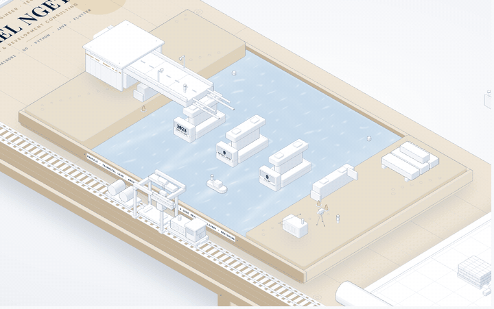
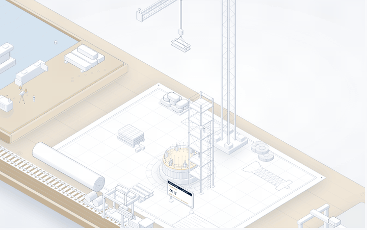
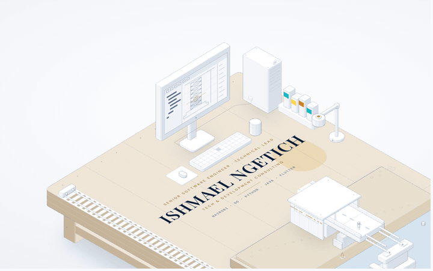
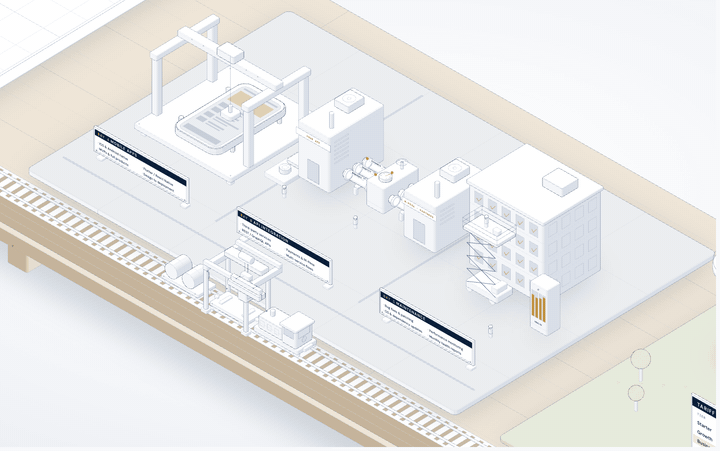
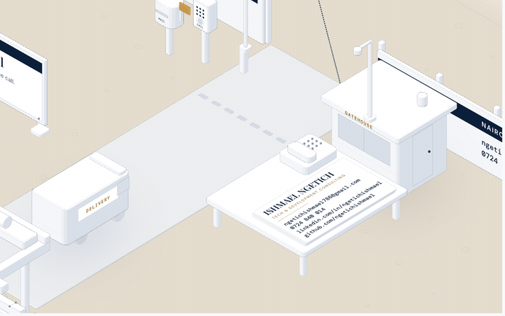

<p align="center"></p>

<h1 align="center">Ishmael Ngetich</h1>

<p align="center">
  <b>Senior Software Engineer · Technical Lead</b><br>
  I build systems that carry real traffic, and the integrations that hold them together.<br>
  Six years across web, mobile and APIs in Nairobi: payments, identity and logistics.
</p>

<p align="center">
  <a href="mailto:ngetichishmael786@gmail.com"></a>
  <a href="https://linkedin.com/in/ngetichishmael"></a>
  
</p>

---

### In numbers

<p align="center"></p>

<table>
  <tr>
    <td align="center" width="33%"><h2>2024</h2>leading development teams as technical lead, teams of five and six</td>
    <td align="center" width="33%"><h2>874</h2>integration endpoints audited end to end across a payments estate</td>
    <td align="center" width="33%"><h2>1M+</h2>daily transactions carried by a platform I architected</td>
  </tr>
</table>

### What I'm building

- **Savannah Systems**: multi-tenant logistics platform in Go, three brands on one engine. I lead a team of six.
- **Jubilee Life Portal**: ten FastAPI services behind a life and pension portal, and an 874-endpoint payments audit.
- **AIMS v2**: property management where every action goes through one policy engine.
- **Relay**: WhatsApp Business messaging with signed delivery receipts.
- **CheQBuy**: shopping with local delivery and M-Pesa, card, PayPal or bank payments.
- **Washamba**: agri marketplace with a farmer's wallet on M-Pesa and KCB, plus USSD.
- **Praxis**: my offline spaced-repetition study app, in Rust and Tauri.

### Six years, one rack

<p align="center"></p>

```text
2026  Jubilee (via Shinrai)   874 integration endpoints audited
2025  Savannah Systems        9 build flavours, 144 migrations, team of six
2024  Real Sources Africa     Go + gRPC platform at 1M+ transactions a day
2024  RBC                     p95 latency cut from 800 ms to 480 ms
2023  Sokoflow                PHP monolith split into eight Go services
2021  Deveint                 page load time down 40%
2020  Oriol                   Android app rating 3.8 → 4.5
2017  Chuka University        B.Sc → M.Sc
```

### Tools I reach for

<p align="center"></p>

<p>
  
  
  
  
  
  
  
  
  
  
  
  
  
</p>

### Work with me

<p align="center"></p>

- **Mobile apps**: native iOS and Android, or cross-platform with Flutter, from MVP to full product.
- **API integration**: payment gateways and M-Pesa, third-party services, REST and GraphQL, multi-service orchestration.
- **Monthly maintenance**: bug fixes and patching, performance monitoring, dependency updates, monthly health reports.

### Get in touch

<p align="center"></p>

Every project starts with a free scoping call: [ngetichishmael786@gmail.com](mailto:ngetichishmael786@gmail.com?subject=Scoping%20call) · 0724 840 014

<sub>Outside client work I'm exploring applied AI and machine learning, robotics and quantum computing.</sub>
